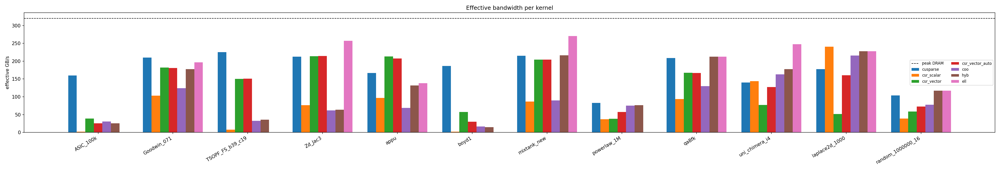
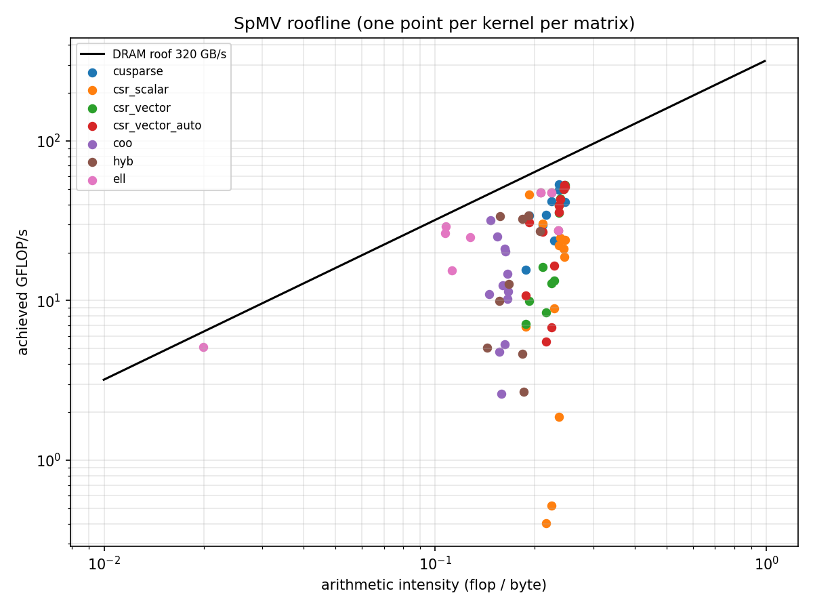

# SpMV on CUDA: five kernels, one benchmark

Five sparse matrix-vector multiply (SpMV) kernels written in CUDA — **CSR-scalar,
CSR-vector, ELL, COO and HYB** — benchmarked on real SuiteSparse matrices against
NVIDIA's cuSPARSE library, with profiler evidence for why each storage format wins or
loses on a given matrix shape. The project follows Bell & Garland, *Efficient Sparse
Matrix-Vector Multiplication on CUDA* (NVIDIA Research, 2008).

> **Headline result (Tesla T4, 9 real SuiteSparse matrices + 3 synthetic):** the
> fastest of our kernels on each real matrix runs at **0.24×–1.28× the speed of
> cuSPARSE**, and beats it on 3 of the 9 (appu 1.28×, uni_chimera_i4 1.15×, Zd_Jac3
> 1.01×). On real matrices our best bandwidth is **67% of peak** (215 GB/s, CSR-vector on
> Zd_Jac3); cuSPARSE reaches 44–71%. The largest gap is on matrices with a few very long
> rows, where our best kernel manages only 0.24–0.67× cuSPARSE. These are timing results
> only; Nsight profiling is still to do (§19).

| | |
|---|---|
| GPU | Tesla T4 (sm_75, 15 GB), peak DRAM bandwidth 320 GB/s (spec sheet, passed as `--peak-bw 320`) |
| CUDA toolkit / driver | 12.8 (V12.8.93) / 580.178.04, on Kaggle |
| cuSPARSE algorithm | `CUSPARSE_SPMV_ALG_DEFAULT` |
| Precision | fp32 values, 32-bit indices |

---

## Contents

1. [What this project does](#1-what-this-project-does)
2. [Background: why SpMV is hard on a GPU](#2-background-why-spmv-is-hard-on-a-gpu)
3. [The storage formats](#3-the-storage-formats)
4. [The kernels](#4-the-kernels)
5. [Repository layout](#5-repository-layout)
6. [Requirements](#6-requirements)
7. [Building](#7-building)
8. [Running the benchmark](#8-running-the-benchmark)
9. [Output: console table and CSV](#9-output-console-table-and-csv)
10. [How things are measured](#10-how-things-are-measured)
11. [Test matrices](#11-test-matrices)
12. [Scripts](#12-scripts)
13. [Profiling with Nsight Compute](#13-profiling-with-nsight-compute)
14. [Reading the roofline plot](#14-reading-the-roofline-plot)
15. [Tests](#15-tests)
16. [Results](#16-results)
17. [What I learned](#17-what-i-learned)
18. [Troubleshooting](#18-troubleshooting)
19. [Known limitations / next steps](#19-known-limitations--next-steps)
20. [References](#20-references)

---

## 1. What this project does

SpMV computes **y = A·x**, where A is a large matrix that is mostly zeros, so only its
nonzeros are stored. It is the core operation of iterative solvers (Conjugate
Gradient, GMRES), PageRank and graph analytics, and many scientific simulations.

This repository:

- **Builds** five GPU kernels, each using a different way of storing A, plus a CPU
  reference and a cuSPARSE baseline.
- **Measures** runtime, GFLOP/s and achieved memory bandwidth (GB/s and % of the GPU's
  peak) for every kernel on every matrix.
- **Explains** the results with Nsight Compute metrics and a roofline plot.
- **Reproduces** everything — build, tests, downloads, benchmark, charts — with one
  command (`scripts/run_all.sh`).

## 2. Background: why SpMV is hard on a GPU

Each stored nonzero does **2 floating-point operations** (one multiply, one add) but
needs at least **12 bytes** of memory traffic: a 4-byte value, a 4-byte column index
and a 4-byte entry of x. The arithmetic intensity is therefore about

```
intensity ≈ 2·nnz / (12·nnz + 4·(rows+1) + 4·rows) ≈ 0.17 flop/byte  (fp32)
```

A modern GPU needs tens of flops per byte to be compute-bound, so **SpMV is always
limited by memory bandwidth**. The only ways to go faster are to move fewer bytes or
to move them more efficiently. Three things decide how efficiently a kernel uses
memory:

| Factor | What it means | What goes wrong |
|---|---|---|
| **Coalescing** | The 32 threads of a warp should read neighbouring addresses so one memory transaction serves them all. | Each thread reads a different, far-apart address → up to 32 transactions instead of 1. |
| **Load balance** | Every thread should have a similar amount of work. | Rows with 5 nonzeros sit idle while one thread grinds through a row with 5,000. |
| **Reuse of x** | Reads of x follow the column indices, so they are scattered. | If the columns jump around, x keeps missing in cache and is re-read from DRAM. |

Each storage format is a different trade-off between these three, which is why **no
single format wins on every matrix**.

## 3. The storage formats

All examples use this 4×4 matrix (it is also `tests/data/small.mtx`):

```
    A = | 1  0  2  0 |      row lengths: 2, 1, 3, 0
        | 0  3  0  0 |
        | 4  0  5  6 |
        | 0  0  0  0 |
```

### CSR (Compressed Sparse Row)

Nonzeros are stored row by row; `row_ptr[r]` is where row r starts.

```
row_ptr = [0, 2, 3, 6, 6]
col_idx = [0, 2,  1,  0, 2, 3]
vals    = [1, 2,  3,  4, 5, 6]
```

Compact (8 bytes per nonzero plus one int per row) and the most common format, but
row lengths vary, which makes load balance hard.

### ELL (ELLPACK)

Every row is padded to the same length (the longest row, here 3). Padding has column
index `-1`. The data is stored **column-major** — entry k of row r lives at
`[k * rows + r]` — so that consecutive threads (rows) read consecutive addresses.

```
         k=0  k=1  k=2
row 0:  [ 0,   2,  -1 ]          col_idx, column-major in memory:
row 1:  [ 1,  -1,  -1 ]          [0, 1, 0, -1,   2, -1, 2, -1,   -1, -1, 3, -1]
row 2:  [ 0,   2,   3 ]           └─ k=0 ──┘     └─ k=1 ──┘      └─ k=2 ───┘
row 3:  [-1,  -1,  -1 ]
```

Perfect coalescing on regular matrices, but one long row forces padding on every
row. The **padding ratio** `rows × max_row / nnz` measures this (here 4×3/6 = 2.0).

### COO (Coordinate)

One `(row, col, value)` triple per nonzero, sorted by row.

```
row_idx = [0, 0, 1, 2, 2, 2]
col_idx = [0, 2, 1, 0, 2, 3]
vals    = [1, 2, 3, 4, 5, 6]
```

12 bytes per nonzero. Work per thread is identical regardless of row lengths, but
threads that share a row must combine their results with atomic additions.

### HYB (Hybrid ELL + COO)

The first **k** entries of each row go into ELL; anything beyond k goes into COO.
k is chosen with the Bell & Garland rule: **the largest row length that at least one
third of the rows reach.** For the example, rows reach length ≥2 in 2 of 4 rows (≥ ⅓)
but length ≥3 in only 1 of 4, so **k = 2**: the ELL part has width 2 and row 2's third
entry (column 3, value 6) goes to COO. ELL handles the regular bulk; COO absorbs the
long tail without blowing up the padding.

## 4. The kernels

All kernels compute y = A·x in fp32, use 256 threads per block, and loop with a
**grid-stride loop** (the grid is capped at 32 blocks per SM, and each thread handles
more than one item if needed).

| CSV name | File | Thread mapping | Good at | Bad at |
|---|---|---|---|---|
| `csr_scalar` | `src/spmv_csr.cu` | 1 thread per row | very short, even rows | uncoalesced reads; one long row stalls its warp |
| `csr_vector` | `src/spmv_csr.cu` | 1 warp (32 lanes) per row | rows with 32+ nonzeros | wastes most of the warp on short rows |
| `csr_vector_auto` | `src/spmv_csr.cu` | 2/4/8/16/32 lanes per row | adapts to the mean row length | still one width for the whole matrix |
| `ell` | `src/spmv_ell.cu` | 1 thread per row, column-major | regular matrices (banded, FEM) | padding explodes with one long row |
| `coo` | `src/spmv_coo.cu` | 1 thread per nonzero, `atomicAdd` | perfect load balance on any shape | atomic contention on dense rows; 12 B/nnz |
| `hyb` | `src/spmv_hyb.cu` | `ell` for first k, then `coo` | mixed and power-law matrices | two launches; depends on k |
| `cusparse` | `src/bench.cu` | `cusparseSpMV` on CSR | baseline | — |

### Kernel details

**CSR-scalar.** Thread `row` walks `row_ptr[row] .. row_ptr[row+1]` and sums
`vals[p] * x[col_idx[p]]`. Simple, but neighbouring threads read from different rows,
so a warp's loads are spread across memory, and the warp finishes only when its
longest row does.

**CSR-vector.** `Width` lanes cooperate on one row: lane `i` handles nonzeros
`i, i+Width, i+2·Width, …` of the row, so the lanes read a contiguous chunk
(coalesced). The partial sums are combined with `__shfl_down_sync` (a warp-level
tree reduction, log₂(Width) steps), and lane 0 writes `y[row]`. The loop over rows is
arranged so the loop bound is the same for the whole warp, which guarantees all 32
lanes reach the full-mask shuffle.
- `csr_vector` always uses Width = 32 (one warp per row, as in Bell & Garland).
- `csr_vector_auto` picks the smallest power of two ≥ the mean row length, between 2
  and 32 (e.g. mean 7.3 → 8 lanes, so four rows share a warp). The chosen width is
  shown in the `note` column.

**ELL.** Thread `row` loops `k = 0 .. width-1`, reading `col_idx[k*rows + row]` and
`vals[k*rows + row]`. At each step k the warp reads 32 consecutive addresses. Because
padding always comes after a row's real entries, the loop stops at the first `-1`.
The benchmark **skips ELL when the padding ratio exceeds 20×** (e.g. webbase-1M,
where ELL would need tens of GB); the row shows `skipped` with note `padding too large`.

**COO.** Thread `i` computes `vals[i] * x[col_idx[i]]` and does
`atomicAdd(&y[row_idx[i]], …)`. y is zeroed first with `cudaMemsetAsync` (included in
the timed launch). Load balance is perfect, but every nonzero of a dense row hits the
same address, so atomics on that address serialise.

**HYB.** Launches the ELL kernel on the width-k part (which writes every `y[row]`,
including 0 for rows with no ELL entries), then the COO kernel adds the overflow
entries on top. Both run on the default stream, so they execute in order.

**cuSPARSE.** The generic `cusparseSpMV` API on the same CSR arrays, with
`CUSPARSE_SPMV_ALG_DEFAULT`, α = 1, β = 0. Its handle, descriptors and work buffer are
created once per matrix (reported as its `conv_ms`) and are not part of the timed call.

### Optional: `__ldg` read-only cache

Every kernel reads x through a `LOAD_X` macro (`include/cuda_utils.h`). Building with
`-DSPMV_USE_LDG=ON` turns it into `__ldg(...)`, which routes reads of x through the
read-only/texture cache path. Build once with and once without to get before/after
numbers for this optimisation.

## 5. Repository layout

```
.
├── CMakeLists.txt          build: host library, CPU tests, CUDA benchmark
├── README.md
├── requirements.txt        matplotlib (charts only)
├── include/
│   ├── formats.h           CSR / ELL / COO / HYB host structs, converters, generators, CPU reference
│   ├── mmio.h              Matrix Market reader declaration
│   ├── cuda_utils.h        CUDA_CHECK, grid_size(), LOAD_X (optional __ldg)
│   └── spmv_kernels.h      device structs (DeviceCsr/Ell/Coo/Hyb) + kernel launch wrappers
├── src/
│   ├── mmio.cpp            .mtx reader (general/symmetric; real/integer/pattern)
│   ├── convert.cpp         triplets → CSR, CSR → ELL / COO / HYB, HYB k rule, matrix stats
│   ├── generate.cpp        synthetic 2D Laplacian and uniform-random matrices
│   ├── spmv_cpu.cpp        CPU reference SpMV (double accumulation)
│   ├── spmv_csr.cu         CSR-scalar and CSR-vector kernels
│   ├── spmv_ell.cu         ELL kernel
│   ├── spmv_coo.cu         COO kernel (atomicAdd)
│   ├── spmv_hyb.cu         HYB = ELL launch + COO launch
│   └── bench.cu            benchmark harness, cuSPARSE baseline, CSV output
├── tests/
│   ├── test_cpu.cpp        reader, converters and CPU reference on hand-checked matrices
│   └── data/               small.mtx (general, unsorted, empty row), sym.mtx (symmetric)
├── scripts/
│   ├── get_matrices.sh     downloads the SuiteSparse test set into matrices/
│   ├── matrix_stats.py     Markdown stats table for the report
│   ├── plot.py             GB/s bar chart + roofline from results.csv
│   ├── profile.sh          Nsight Compute metrics per kernel per matrix
│   └── run_all.sh          one command: build → test → download → stats → bench → plots
├── matrices/               (created by get_matrices.sh, git-ignored)
└── results/                (created by the scripts) results.csv, charts, logs, ncu/
```

## 6. Requirements

| Need | Version | Used for |
|---|---|---|
| NVIDIA GPU | any CUDA-capable | running the kernels |
| CUDA toolkit | 11.2 or newer (cuSPARSE generic SpMV API) | `nvcc`, cuSPARSE |
| CMake | ≥ 3.18 (≥ 3.24 for automatic GPU detection) | build |
| C++ compiler | C++17 (GCC ≥ 9 or Clang) | host code |
| Python 3 | ≥ 3.8 | stats and plots |
| matplotlib | ≥ 3.5 | `plot.py` only |
| curl | any | `get_matrices.sh` |
| Nsight Compute (`ncu`) | optional | `profile.sh` |

Any NVIDIA GPU works: a lab machine, a laptop RTX card, or a free Google Colab /
Kaggle T4. Note that Nsight Compute is often not permitted on Colab; use a local or lab
GPU for profiling.

## 7. Building

```bash
cmake -S . -B build
cmake --build build -j
```

This produces `build/spmv_bench` (the benchmark) and `build/test_cpu` (CPU tests).

**CMake options**

| Option | Default | Effect |
|---|---|---|
| `CMAKE_CUDA_ARCHITECTURES` | `native` | GPU architecture to compile for. `native` detects the local GPU (CMake ≥ 3.24). Otherwise set it: `75` T4 / RTX 20xx, `80` A100, `86` RTX 30xx, `89` RTX 40xx, `90` H100. |
| `SPMV_USE_LDG` | `OFF` | Read x through `__ldg` (see §4). |
| `SPMV_CPU_ONLY` | `OFF` | Build only the host library and CPU tests — no CUDA toolkit needed. Handy for checking the reader/converters on a laptop. |
| `CMAKE_BUILD_TYPE` | `Release` | Standard CMake build type. |

Examples:

```bash
cmake -S . -B build -DCMAKE_CUDA_ARCHITECTURES=75              # Colab / Kaggle T4
cmake -S . -B build-ldg -DSPMV_USE_LDG=ON                       # __ldg variant
cmake -S . -B build-cpu -DSPMV_CPU_ONLY=ON && cmake --build build-cpu && ./build-cpu/test_cpu
```

The CUDA code is compiled with `-lineinfo`, so Nsight Compute can map metrics back to
source lines.

## 8. Running the benchmark

```
build/spmv_bench [--kernels a,b,...] [--iters N] [--warmup N] [--peak-bw GB/s] [--csv PATH] MATRIX...
```

| Option | Default | Meaning |
|---|---|---|
| `--kernels` | all | Comma-separated subset of `csr_scalar csr_vector csr_vector_auto ell coo hyb cusparse`. |
| `--iters` | 100 | Timed launches per kernel; the median is reported. |
| `--warmup` | 5 | Untimed launches before timing. |
| `--peak-bw` | from device | Peak DRAM bandwidth in GB/s used for `% of peak`. By default it is computed as 2 × memory clock × bus width from the device attributes. Pass the spec-sheet value if that looks wrong. |
| `--csv` | `results/results.csv` | File to append results to (created with a header if missing). `--csv ""` disables CSV output. |

**MATRIX** can be:

| Spec | Meaning |
|---|---|
| `path/to/file.mtx` | A Matrix Market file (coordinate format; real, integer or pattern; general or symmetric). The name in the results is the file name without `.mtx`. |
| `laplace2d:N` | 5-point 2D Laplacian on an N×N grid (N² rows, ≤5 nonzeros per row). Name `laplace2d_N`. |
| `random:ROWS:PER_ROW` | ROWS×ROWS matrix with PER_ROW distinct uniformly random columns per row, values in [−1, 1]. Name `random_ROWS_PER_ROW`. |

Examples:

```bash
# Everything on one matrix
./build/spmv_bench matrices/cant.mtx

# Several matrices, a subset of kernels, quick run, no CSV
./build/spmv_bench --kernels csr_vector,ell,cusparse --iters 20 --csv "" matrices/*.mtx

# Synthetic matrices only (no download needed)
./build/spmv_bench laplace2d:1000 random:1000000:16

# T4 peak bandwidth from its spec sheet
./build/spmv_bench --peak-bw 320 matrices/*.mtx
```

The program exits with a non-zero status if a matrix could not be loaded or processed.
A kernel that gives a wrong answer does **not** stop the run; it is marked `FAIL`.

## 9. Output: console table and CSV

For each matrix the benchmark prints its shape and a table:

```
cant: R x C, nnz N, row length mean M max X, ELL padding P.Px, HYB k=K (F% in COO)
  kernel           status   median ms  GFLOP/s     GB/s   %peak  vs cuSP  conv ms  max err
  cusparse         ok          ...                                1.00x
  csr_scalar       ok          ...
  ...
```

(Layout only — run it to get real numbers.)

**CSV columns** (`results/results.csv`, one row per kernel per matrix):

| Column | Meaning |
|---|---|
| `gpu` | Device name |
| `matrix` | Matrix name |
| `rows`, `nnz` | Matrix size |
| `kernel` | Kernel name (see §4) |
| `status` | `ok`, `FAIL` (wrong result) or `skipped` (e.g. ELL padding too large) |
| `median_ms` | Median time of one SpMV over `--iters` launches |
| `gflops` | 2·nnz / time |
| `gbps` | Effective bandwidth: bytes of A in this format + x + y, divided by time |
| `pct_peak` | `gbps` as a percentage of the peak DRAM bandwidth |
| `intensity` | 2·nnz / bytes (x-axis of the roofline) |
| `conv_ms` | Host-side time to convert CSR into this format (cuSPARSE: setup time) |
| `max_rel_err` | Worst per-row error against the CPU reference (see §10) |
| `speedup_vs_cusparse` | t_cusparse / t_kernel (> 1 means faster than cuSPARSE) |
| `peak_bw_gbps` | Peak bandwidth used for `pct_peak` |
| `note` | Extra info: chosen CSR-vector width, HYB k, or skip reason |

The CSV is appended to, so several runs (e.g. with and without `__ldg`) can share one
file; `plot.py` keeps the last row for each (matrix, kernel).

## 10. How things are measured

**Timing.** Each kernel gets 5 warm-up launches, then 100 launches, each bracketed by
its own pair of `cudaEvent`s; the **median** is reported because it ignores the odd
slow launch. Host-to-device copies are excluded. Format conversion (CSR → ELL/COO/HYB
on the CPU) is timed separately and reported as `conv_ms`.

**Correctness.** Before timing, y is filled with NaN (so a kernel that skips a row
cannot pass on stale data), the kernel runs once, and every row is compared with a CPU
reference computed in double precision:

```
error(row) = |y_gpu − y_ref| / Σ_j |a_ij · x_j|        pass if max error ≤ 1e-5
```

Dividing by the sum of absolute products (instead of |y_ref|) means rows whose terms
cancel to nearly zero do not fail just because of normal fp32 rounding. x is filled
with uniform random values in [−1, 1] (fixed seed 42), so runs are reproducible.

**Metrics.**

```
GFLOP/s       = 2·nnz / (t · 1e9)
Effective GB/s = (bytes of A + 4·cols + 4·rows) / (t · 1e9)
% of peak     = Effective GB/s / peak DRAM GB/s × 100
```

"Bytes of A" depends on the format, because that is what each kernel actually reads:

| Format | Bytes of A |
|---|---|
| CSR (`csr_*`, `cusparse`) | 4·(rows+1) + 8·nnz |
| ELL | 8 · rows · width (padding included — it is real traffic) |
| COO | 12 · nnz |
| HYB | 8 · rows · k + 12 · nnz_in_COO |

**% of peak is the headline number**: it says how close a kernel gets to the hardware
limit for a memory-bound operation.

## 11. Test matrices

### Matrices used for the results in §16

The plan was the Bell & Garland set (below), but **sparse.tamu.edu returned HTTP 403
from Kaggle**, so the T4 run used SuiteSparse matrices from the Hugging Face mirror
[`Csed-dev/matrixpfn-suitesparse`](https://huggingface.co/datasets/Csed-dev/matrixpfn-suitesparse)
instead (`scripts/get_matrices_hf.py`). The script reads the mirror's catalogue, keeps
matrices with at least 500,000 nonzeros, splits them into 9 groups by mean row length,
and takes the largest matrix in each group, so the set covers short, medium and long
rows. Every matrix it picked has under 2.0M nonzeros.

| Matrix | Domain (from the mirror's catalogue) | Rows | nnz | Mean row | Max row | ELL padding |
|---|---|---|---|---|---|---|
| uni_chimera_i4 | undirected weighted graph | 100,000 | 814,436 | 8.1 | 18 | 2.2× |
| ASIC_100k | circuit simulation | 99,340 | 954,163 | 9.6 | 99,029 | 10,310× |
| boyd1 | optimization | 93,279 | 1,211,231 | 13.0 | 93,261 | 7,182× |
| qa8fk | acoustics | 66,127 | 1,660,579 | 25.1 | 27 | 1.1× |
| TSOPF_FS_b39_c19 | power network | 76,216 | 1,977,600 | 25.9 | 38,024 | 1,465× |
| Goodwin_071 | computational fluid dynamics | 56,021 | 1,797,934 | 32.1 | 62 | 1.9× |
| mixtank_new | computational fluid dynamics | 29,957 | 1,995,041 | 66.6 | 154 | 2.3× |
| Zd_Jac3 | chemical process simulation | 22,835 | 1,916,152 | 83.9 | 1,050 | 12.5× |
| appu | directed weighted random graph | 14,000 | 1,853,104 | 132.4 | 294 | 2.2× |
| `powerlaw_1M` (synthetic) | web-graph-like power law | 1,000,000 | 4,513,732 | 4.5 | 4,993 | 1,106× |
| `laplace2d:1000` (synthetic) | 5-point stencil | 1,000,000 | 4,996,000 | 5.0 | 5 | 1.0× |
| `random:1000000:16` (synthetic) | uniform random columns | 1,000,000 | 16,000,000 | 16.0 | 16 | 1.0× |

`powerlaw_1M` replaces webbase-1M as the power-law worst case for ELL. It is generated by
`scripts/get_matrices_hf.py` (Pareto row lengths, ×2, capped at 5,000; random columns;
seed 7). The file has 4,513,924 entries; the reader sums the duplicate (row, column)
pairs, leaving the 4,513,732 nonzeros benchmarked. (`results/matrix_stats.md` counts the
raw 4,513,924 because the Python script does not merge duplicates.) The numbers in this
table are the benchmark's own, after symmetric matrices are expanded to full storage.

### Original plan: the Bell & Garland set

These are the standard matrices used by Bell & Garland and later SpMV papers, so
numbers on them can be compared with published results. `scripts/get_matrices.sh`
downloads them on machines that can reach sparse.tamu.edu. They were **not** used for
the T4 results.

| Matrix | Shape of rows | Why include it | Expected winner |
|---|---|---|---|
| `laplace2d:1000` (synthetic) | perfectly uniform, ≤5 per row | sanity check, best case for ELL | ELL |
| cant, pwtk, shipsec1 (FEM) | uniform, ~30–60 per row | regular scientific matrices | ELL / CSR-vector |
| consph, pdb1HYS | dense-ish rows, ~70–120 per row | long rows reward warp-per-row | CSR-vector |
| rma10, cop20k_A | moderately irregular | middle ground | HYB |
| mac_econ_fwd500, scircuit | mostly short rows, a few long ones | load imbalance appears | HYB / COO |
| webbase-1M | power-law (web graph) | worst case for ELL padding | COO / HYB |
| `random:1000000:16` (synthetic) | uniform length, random columns | poor cache reuse of x | compare all |

Symmetric matrices are stored as one triangle in the file; the reader expands them to
full storage, so `nnz` in the results counts both triangles.

## 12. Scripts

| Script | What it does |
|---|---|
| `scripts/get_matrices.sh [DIR]` | Downloads the 10 SuiteSparse matrices into `matrices/` (or DIR), skipping ones already present. Needs `curl`. |
| `scripts/matrix_stats.py FILE.mtx...` | Prints a Markdown table: rows, nnz, mean and max nonzeros per row, ELL padding ratio, HYB k and % of nonzeros HYB puts in COO. Standard library only. The same numbers appear in the benchmark's per-matrix header line. |
| `scripts/plot.py [CSV] [OUTDIR]` | Reads `results.csv` and writes `gbps.png` (effective GB/s per kernel per matrix, with the peak line) and `roofline.png`. Needs matplotlib. |
| `scripts/profile.sh [MATRIX...]` | Runs Nsight Compute for each kernel on each matrix (default: cant, webbase-1M, `laplace2d:1000`) and writes one CSV per pair to `results/ncu/`. See §13. |
| `scripts/run_all.sh [bench args]` | The one-command reproduction: configure + build, run CPU tests, download matrices, write `results/matrix_stats.md`, start a fresh `results/results.csv`, run the benchmark on all matrices plus `laplace2d:1000` and `random:1000000:16` (log in `results/bench_log.txt`), then plot. Extra arguments are passed to `spmv_bench`, e.g. `scripts/run_all.sh --peak-bw 320`. |

Full reproduction on a fresh machine:

```bash
pip install -r requirements.txt
scripts/run_all.sh
```

## 13. Profiling with Nsight Compute

```bash
scripts/profile.sh                                   # default matrices
scripts/profile.sh matrices/consph.mtx matrices/scircuit.mtx
```

For each (matrix, kernel) the script runs `spmv_bench --kernels K --warmup 0 --iters 1`
under `ncu`, so only that kernel is profiled (one correctness launch plus one timed
launch; cuSPARSE may launch more than one internal kernel). Output:
`results/ncu/<matrix>_<kernel>.csv`.

| Metric | ncu name | What it tells you |
|---|---|---|
| DRAM throughput | `dram__throughput.avg.pct_of_peak_sustained_elapsed` | How close to peak bandwidth the kernel ran. |
| Sectors per request | `l1tex__t_sectors_pipe_lsu_mem_global_op_ld.sum` ÷ `l1tex__t_requests_pipe_lsu_mem_global_op_ld.sum` | Coalescing: ~4 is ideal for 4-byte loads by a full warp; much higher means scattered loads (expect CSR-scalar ≫ CSR-vector). |
| Warp execution efficiency | `smsp__thread_inst_executed_per_inst_executed.ratio` ÷ 32 | Fraction of lanes doing useful work (idle lanes from divergence or short rows). |
| Achieved occupancy | `sm__warps_active.avg.pct_of_peak_sustained_active` | How many warps were resident to hide memory latency. |
| L2 hit rate | `lts__t_sector_hit_rate.pct` | Reuse of x (expect low on `random`, high on banded matrices). |

Use these to explain each result in one or two sentences, e.g. *"CSR-scalar on cant
needs N sectors per request vs. M for CSR-vector, so it moves far more data for the
same work."*

## 14. Reading the roofline plot

`results/roofline.png` plots each (kernel, matrix) as a point: arithmetic intensity
(flop/byte) on the x-axis, achieved GFLOP/s on the y-axis, both log scale. The sloped
line is `GFLOP/s = peak GB/s × intensity` — the best any memory-bound kernel can do at
that intensity.

- Every SpMV point should sit **under** the line (all around 0.1–0.2 flop/byte).
- The **vertical gap** to the line is how much bandwidth the kernel left unused.
- Formats that move more bytes per nonzero (COO at 12 B, ELL with padding) sit further
  **left** — lower intensity, so a lower ceiling even if they run at full bandwidth.

## 15. Tests

`build/test_cpu` (also run by `ctest` and `run_all.sh`) checks, without a GPU:

- The reader on `small.mtx` (general, entries out of order, an empty row) and
  `sym.mtx` (symmetric expansion).
- Hand-computed products: `A·[1 2 3 4] = [7 6 43 0]`, symmetric `A·[1 1 1] = [1 −2 1]`.
- Duplicate entries are summed; ELL is column-major with `-1` padding; HYB picks k = 2
  on the example.
- ELL, COO and HYB give the same y as CSR on the small matrices, a Laplacian, a random
  matrix and a power-law-like matrix with one 90-entry row.

GPU correctness is checked by the benchmark itself on every run (§10).

## 16. Results

Tesla T4 on Kaggle, CUDA 12.8, peak 320 GB/s, 5 warm-ups + median of 100 launches.
Every kernel passed the correctness check on every matrix it ran on. ELL was skipped on
the four matrices whose padding ratio is above 20× (ASIC_100k, boyd1, TSOPF_FS_b39_c19,
powerlaw_1M). Raw data: `results/results.csv`, `results/results_ldg.csv`,
`results/bench_log.txt`, `results/matrix_stats.md`. All tables below are printed by
`python3 scripts/analyze.py`. Each number comes from one run, so small differences
(a few %) should not be read as real.

### Bandwidth per kernel per matrix



ELL bars count padding as traffic, so they can look high while the kernel is slow (see
§17).

### Roofline



All points sit under the 320 GB/s roof, as expected for a memory-bound kernel.

### Best kernel per matrix

"Best" is the fastest of our kernels (cuSPARSE excluded). **% peak** uses that kernel's
own byte count (ELL/HYB padding included). **Useful % peak** uses the CSR byte count
for every kernel, i.e. the minimum traffic the multiply needs, so it is comparable
across formats. Ties are within 1%.

| Matrix | Mean / max row | Best kernel | Time (ms) | % peak | Useful % peak | vs cuSPARSE | cuSPARSE ms (% peak) |
|---|---|---|---|---|---|---|---|
| uni_chimera_i4 | 8.1 / 18 | hyb | 0.0479 | 55.6 | 50.3 | **1.15×** | 0.0550 (43.8) |
| ASIC_100k | 9.6 / 99,029 | csr_vector | 0.2263 | 12.2 | 12.2 | 0.24× | 0.0553 (49.9) |
| boyd1 | 13.0 / 93,261 | csr_vector | 0.1884 | 17.9 | 17.9 | 0.31× | 0.0580 (58.3) |
| qa8fk | 25.1 / 27 | ell (tie: hyb) | 0.0696 | 66.5 | 63.2 | 0.97× | 0.0675 (65.2) |
| TSOPF_FS_b39_c19 | 25.9 / 38,024 | csr_vector_auto (tie: csr_vector) | 0.1110 | 47.1 | 47.1 | 0.67× | 0.0742 (70.5) |
| Goodwin_071 | 32.1 / 62 | csr_vector (tie: csr_vector_auto) | 0.0828 | 56.8 | 56.8 | 0.86× | 0.0716 (65.7) |
| mixtank_new | 66.6 / 154 | csr_vector (tie: csr_vector_auto) | 0.0798 | 63.9 | 63.9 | 0.95× | 0.0758 (67.3) |
| Zd_Jac3 | 83.9 / 1,050 | csr_vector_auto (tie: csr_vector) | 0.0727 | 67.1 | 67.1 | **1.01×** | 0.0734 (66.4) |
| appu | 132.4 / 294 | csr_vector | 0.0702 | 66.7 | 66.7 | **1.28×** | 0.0897 (52.2) |
| powerlaw_1M | 4.5 / 4,993 | hyb | 0.7078 | 23.9 | 21.2 | 0.82× | 0.5796 (25.9) |
| laplace2d_1000 | 5.0 / 5 | ell (tie: hyb) | 0.2108 | 71.2 | 77.1 | **1.39×** | 0.2928 (55.5) |
| random_1000000_16 | 16.0 / 16 | ell (tie: hyb) | 1.1611 | 36.6 | 37.7 | **1.16×** | 1.3478 (32.5) |

Other kernels that also beat cuSPARSE: csr_scalar on laplace2d_1000 (1.36×) and
uni_chimera_i4 (1.03×), and csr_vector_auto on appu (1.24×).

### `__ldg` build vs default build

Same benchmark rebuilt with `-DSPMV_USE_LDG=ON` (`results/results_ldg.csv`). Ratio =
default time / `__ldg` time, so **> 1 means `__ldg` is faster**. cuSPARSE does not use
our `LOAD_X` macro, so its ratio shows how much timings drift between the two runs.

| Kernel | Median ratio | Worst | Best |
|---|---|---|---|
| cusparse (control) | 1.00× | 0.99× (TSOPF_FS_b39_c19) | 1.05× (boyd1) |
| csr_scalar | 0.68× | 0.40× (boyd1) | 1.19× (uni_chimera_i4) |
| csr_vector | 0.95× | 0.36× (boyd1) | 1.08× (mixtank_new) |
| csr_vector_auto | 0.95× | 0.34× (ASIC_100k) | 1.08× (mixtank_new) |
| ell | 0.99× | 0.99× | 1.00× |
| coo | 1.00× | 0.97× (appu) | 1.00× |
| hyb | 1.00× | 0.98× (uni_chimera_i4) | 1.00× |

Largest slowdowns:

| Matrix | Kernel | Default ms | `__ldg` ms | Ratio |
|---|---|---|---|---|
| ASIC_100k | csr_vector_auto | 0.3444 | 1.0197 | 0.34× |
| boyd1 | csr_vector | 0.1884 | 0.5237 | 0.36× |
| ASIC_100k | csr_vector | 0.2263 | 0.5772 | 0.39× |
| boyd1 | csr_scalar | 4.6556 | 11.7770 | 0.40× |
| ASIC_100k | csr_scalar | 4.7162 | 11.2276 | 0.42× |
| TSOPF_FS_b39_c19 | csr_vector | 0.1112 | 0.2435 | 0.46× |
| Goodwin_071 | csr_scalar | 0.1461 | 0.2662 | 0.55× |
| qa8fk | csr_scalar | 0.1500 | 0.2437 | 0.62× |

cuSPARSE drifts by up to 5% between the runs, so only changes larger than that mean
anything. The only gains above it are csr_vector on mixtank_new (1.08×) and csr_scalar on
uni_chimera_i4 (1.19×); csr_vector on appu (1.04×) is within the drift.

### `csr_vector` (32 lanes) vs `csr_vector_auto`

`csr_vector_auto` picks its width from the mean row length. Speedup = width-32 time /
auto time, so **> 1 means auto is faster**.

| Matrix | Mean / max row | Auto width | Width 32 ms | Auto ms | Speedup of auto |
|---|---|---|---|---|---|
| laplace2d_1000 | 5.0 / 5 | 8 | 1.0006 | 0.3236 | **3.09×** |
| uni_chimera_i4 | 8.1 / 18 | 16 | 0.1003 | 0.0605 | **1.66×** |
| powerlaw_1M | 4.5 / 4,993 | 8 | 1.2638 | 0.8424 | **1.50×** |
| random_1000000_16 | 16.0 / 16 | 16 | 2.3904 | 1.9319 | **1.24×** |
| ASIC_100k | 9.6 / 99,029 | 16 | 0.2263 | 0.3444 | 0.66× |
| boyd1 | 13.0 / 93,261 | 16 | 0.1884 | 0.3567 | 0.53× |
| the other 6 matrices | 25–132 / ≤ 38,024 | 32 | — | — | 0.97–1.00× (same kernel) |

### Conversion cost

Host-side conversion from CSR, compared with the time of one SpMV:

| Format | Max conversion (ms) | Median conversion (ms) | Median conversion / kernel time |
|---|---|---|---|
| ell | 147.6 (Zd_Jac3) | 19.8 | 113× |
| coo | 148.2 (random_1000000_16) | 4.4 | 16× |
| hyb | 121.9 (random_1000000_16) | 8.5 | 65× |

The best kernel on each matrix takes 0.048–1.16 ms.

**Report (4–6 pages):** _link to PDF_

## 17. What I learned

> **These findings come from timing only.** Nsight Compute could not run on Kaggle
> (`ERR_NVGPUCTRPERM`: no access to GPU performance counters), so every "because" below
> is a hypothesis that fits the timings, not something a profiler has confirmed.
> Profiling is the first next step (§19). All numbers are from §16.

**CSR-scalar: good on short, even rows; collapses when one row is huge.** On the 2D
Laplacian (5 per row) it reaches 75.3% of peak (241 GB/s), the highest of any CSR kernel,
and beats cuSPARSE 1.36×; on uni_chimera_i4 (8 per row) it beats cuSPARSE 1.03×. It is
not the fastest on either (ELL/HYB are within 2–12%). On the three matrices with a row
of 38,000–99,000 entries it falls to 0.01–0.04× cuSPARSE (ASIC_100k: 4.72 ms vs
0.055 ms). With one thread per row, a single thread has to walk the whole long row while
the rest of its warp waits. Low warp execution efficiency in Nsight would confirm it.

**CSR-vector: our best kernel on real matrices, but only for medium-to-long rows.** One
of the two CSR-vector settings is our fastest kernel on 7 of the 9 real matrices, and it
beats cuSPARSE on appu (mean 132 per row, 1.28×) and matches it on Zd_Jac3 (1.01×). On
short rows most of the warp has nothing to do: on the Laplacian, 32 lanes for 5 nonzeros
make it 4.6× slower than CSR-scalar (1.00 vs 0.22 ms). `csr_vector_auto` fixes that for
uniform short rows (3.09× faster than width 32 on the Laplacian, 1.66× on
uni_chimera_i4), but it chooses the width from the **mean** row length. On ASIC_100k and
boyd1 the mean (9.6, 13.0) gives width 16, and it runs 1.5× and 1.9× *slower* than
width 32. A plausible reason is that these matrices' time is dominated by a few huge
rows, which then get half as many lanes. The mean is the wrong statistic for skewed
matrices.

**ELL: fastest on uniform matrices — and its % of peak can mislead.** ELL is our
fastest on the Laplacian (1.39× cuSPARSE, 77.1% useful bandwidth — the best in this
study) and on the random matrix (1.16×), and close on qa8fk (0.97×, padding 1.1×). But
its *reported* bandwidth counts the padding as traffic. On mixtank_new it reports
**84.5% of peak**, the highest number in the CSV, yet it is 0.55× cuSPARSE and moves only
37.1% of peak in useful bytes. On Zd_Jac3 (padding 12.5×) it reports 80.4% of peak while
running **10× slower than cuSPARSE** (0.746 vs 0.073 ms), which is 6.5% useful bandwidth.
**Lesson: % of peak only measures efficiency if the bytes counted are bytes the problem
needs.** Compare formats by time, or by bandwidth computed from one common byte count.
Each thread also stops at its row's first padding slot, so the bytes really moved are
somewhere between the useful and the reported count. Nsight's `dram__bytes` would pin it
down. ELL was skipped on 4 of 12 matrices whose padding is above 20×.

**COO: even work per thread did not make it fast.** COO was never our fastest kernel.
At best it reached 0.93× cuSPARSE on the Laplacian and 0.85× on uni_chimera_i4: it reads
12 bytes per nonzero against CSR's ~8. On the long-row matrices it drops to 0.06–0.14×
cuSPARSE (boyd1 0.06×, TSOPF_FS_b39_c19 0.10×, ASIC_100k 0.14×), while cuSPARSE holds
50–71% of peak on the same matrices. The likely reason is atomic contention: every
nonzero of a 93,000-entry row does an `atomicAdd` to the same `y` entry. That is exactly
what the warp-reduced COO kernel (§19) is meant to fix.

**HYB: helps when the overflow is small, inherits COO's problem when it is not.** HYB is
our fastest on uni_chimera_i4 (1.15× cuSPARSE, 5% of nonzeros in COO) and on powerlaw_1M
(0.82×, the best of ours there), and ties ELL on the uniform matrices. Where COO holds a
large share it is as slow as COO: 0.06–0.13× on the long-row matrices (28–49% of nonzeros
in COO). On Zd_Jac3 the "one third of rows" rule picks k = 20 for a mean of 84, which
puts **90% of the nonzeros in COO**: 0.19× cuSPARSE, against 1.01× for CSR-vector. The k
rule needs a guard against this.

**cuSPARSE is the steadiest.** It stays at 44–71% of peak on the real matrices and keeps
50–71% on the long-row ones, where all our kernels struggle. Matching that across every
row shape, rather than winning on a few, is the real gap.

**`__ldg` gave no consistent gain.** The CSR kernels mostly got slower: median 0.68× for
csr_scalar and 0.95× for csr_vector. The worst cases were ASIC_100k csr_scalar 4.72 →
11.23 ms and TSOPF_FS_b39_c19 csr_vector 0.111 → 0.244 ms. The only gains above the 5%
run-to-run drift were csr_vector on mixtank_new (8% faster) and csr_scalar on
uni_chimera_i4 (19% faster). ELL, COO and HYB were unchanged (0.97–1.00×), even though
they read x through the same macro. **The slowdown is unexplained.** One idea to check,
not verified: on sm_75 the compiler may already route `const __restrict__` loads through
the read-only path, so `__ldg` adds nothing. That would explain no gain, but not the
slowdown. The SASS (`cuobjdump -sass`) and Nsight are needed before drawing a conclusion.

**Conversion cost matters.** Converting CSR to ELL takes a median of 113× the kernel's
own time (up to 147.6 ms on Zd_Jac3); COO and HYB conversion reach 148.2 and 121.9 ms on
the random matrix, against 0.05–1.16 ms for the best kernel per matrix. A format other
than CSR only pays off when the same matrix is multiplied many times, e.g. inside an
iterative solver.

## 18. Troubleshooting

| Problem | Fix |
|---|---|
| CMake error about `native` architectures | CMake is older than 3.24. Pass `-DCMAKE_CUDA_ARCHITECTURES=75` (or your GPU's value, see §7). |
| `no kernel image is available for execution on the device` | Built for the wrong architecture; rebuild with the right `CMAKE_CUDA_ARCHITECTURES`. |
| `% peak` looks wrong (e.g. > 100%, or 0) | The device-reported memory clock may be off or unavailable. Pass `--peak-bw` with the spec-sheet value (T4: 320 GB/s). |
| ELL shows `skipped` | Its padding ratio is above 20× (expected for webbase-1M and similar). |
| A kernel shows `FAIL` | Compare `max_rel_err` with 1e-5; a value like `inf` means NaNs or rows never written. |
| `ncu` reports `ERR_NVGPUCTRPERM` | Profiling counters are restricted; run with `sudo` or enable access for non-admin users (see NVIDIA's docs). On Colab, profile elsewhere. |
| `get_matrices.sh` fails | Check internet access to sparse.tamu.edu; rerun — finished matrices are skipped. |
| Out of memory on a small GPU | Run fewer matrices at a time or drop large ones like webbase-1M. |

## 19. Known limitations / next steps

**Next steps**, in the order they matter for the results above:

1. **Nsight Compute profiling on a GPU with counter access.** Kaggle returns
   `ERR_NVGPUCTRPERM`, so `results/` has no profiler data and every explanation in §17 is
   a hypothesis. `scripts/profile.sh` is ready to run on a lab or local GPU. The first
   checks: warp execution efficiency for csr_scalar on ASIC_100k, `dram__bytes` for ELL on
   Zd_Jac3, and atomic throughput for COO on boyd1.
2. **Warp-reduced COO kernel (not built yet).** It would combine equal-row entries
   inside a warp with a segmented reduction, so a dense row issues one atomic per 32
   entries instead of one per entry. This targets COO/HYB on the long-row matrices
   (0.06–0.14× cuSPARSE today). It was dropped from the first version to keep the
   project small.
3. **Investigate the `__ldg` slowdown.** CSR kernels ran up to 3.0× slower with
   `-DSPMV_USE_LDG=ON` (ASIC_100k csr_vector_auto 0.344 → 1.020 ms) while ELL/COO/HYB were
   unchanged. Compare the SASS of both builds and profile both before changing the
   default.
4. **Larger matrices.** Every real matrix in this run has under 2.0M nonzeros (the
   largest is mixtank_new at 1,995,041), so the best kernel takes only 0.05–0.23 ms on
   each of them. The Bell &
   Garland set (e.g. webbase-1M) is still to run, on a machine that can reach
   sparse.tamu.edu, so results can be compared with published numbers.
5. **Merge-based CSR** (Merrill & Garland, SC'16). It gives every thread an equal share
   of rows plus nonzeros, which is the general fix for the long-row matrices where
   csr_scalar falls to 0.01×.
6. **Smaller fixes suggested by §17:** choose the CSR-vector width from more than the
   mean (e.g. the max row length or a percentile), and stop HYB's k rule from sending most
   nonzeros to COO (90% on Zd_Jac3).
7. Later: adaptive format selection from the matrix stats, SpMV inside Conjugate
   Gradient, SpMM.

**Known limitations:** each number is one run (median of 100 launches), with no repeats
across sessions, so differences of a few % are noise (cuSPARSE drifted up to 5% between
the two T4 runs). The project uses fp32 values and 32-bit indices only, a single GPU and
one fixed block size (256). COO uses one atomic per nonzero. The Matrix Market reader
supports coordinate real/integer/pattern, general/symmetric only.

## 20. References

- N. Bell and M. Garland, *Efficient Sparse Matrix-Vector Multiplication on CUDA*,
  NVIDIA Technical Report NVR-2008-004, 2008.
- D. Merrill and M. Garland, *Merge-Based Parallel Sparse Matrix-Vector
  Multiplication*, SC'16.
- SuiteSparse Matrix Collection — <https://sparse.tamu.edu>
- NVIDIA cuSPARSE documentation — generic SpMV API (`cusparseSpMV`).
- NVIDIA Nsight Compute documentation — metrics reference.
